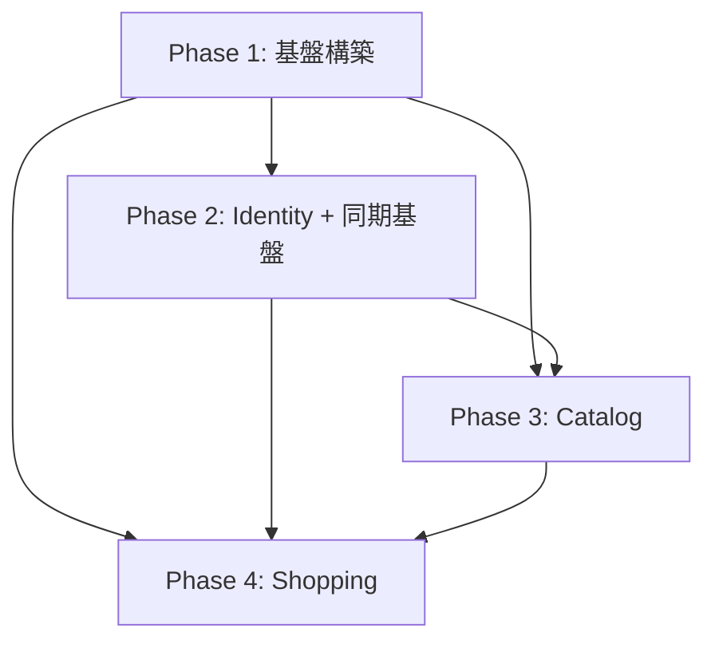

# バックエンド実装タスク一覧

バックエンドアーキテクチャ設計書（ARCHITECTURE.md）に基づく詳細タスク分解。

## 概要

| フェーズ | タスク数 | 概要 |
|---------|---------|------|
| Phase 1 | 28 | 基盤構築（Zod、tRPC、Drizzle、ディレクトリ構造） |
| Phase 2 | 32 | Identity + 同期基盤（認証、グループ、同期エンジン） |
| Phase 3 | 18 | Catalog コンテキスト（アイテム、タグ） |
| Phase 4 | 25 | Shopping コンテキスト（リスト、履歴） |
| **合計** | **103** | |

---

## Phase 1: 基盤構築

### 1.1 Zod導入 + 共有スキーマ（8タスク）

| # | タスク | 説明 | 優先度 |
|---|--------|------|--------|
| 1.1.1 | zodインストール | `npm install zod` | 高 |
| 1.1.2 | 共有ディレクトリ作成 | `src/shared/schemas/`, `src/shared/types/` | 高 |
| 1.1.3 | itemスキーマ定義 | `createItemSchema`, `updateItemSchema` | 高 |
| 1.1.4 | tagスキーマ定義 | `createTagSchema`, `updateTagSchema` | 高 |
| 1.1.5 | listスキーマ定義 | `createListSchema` | 高 |
| 1.1.6 | groupスキーマ定義 | `createGroupSchema`, `inviteMemberSchema` | 高 |
| 1.1.7 | 共通バリデータ作成 | `id`, `pagination`, `dateRange` | 中 |
| 1.1.8 | エクスポートファイル整備 | `src/shared/schemas/index.ts` | 中 |

### 1.2 tRPC基本設定（7タスク）

| # | タスク | 説明 | 優先度 |
|---|--------|------|--------|
| 1.2.1 | tRPCインストール | `@trpc/server`, `@trpc/client`, `@trpc/react-query` | 高 |
| 1.2.2 | tRPCサーバー設定 | `src/infrastructure/trpc/server.ts` | 高 |
| 1.2.3 | コンテキスト作成 | `createContext()` - セッション取得 | 高 |
| 1.2.4 | protectedProcedure定義 | 認証必須のプロシージャ | 高 |
| 1.2.5 | ルーターひな型作成 | `identity`, `catalog`, `shopping` ルーター | 高 |
| 1.2.6 | App RouterのAPI Route設定 | `app/api/trpc/[trpc]/route.ts` | 高 |
| 1.2.7 | tRPCクライアント設定 | `src/infrastructure/trpc/client.ts` | 中 |

### 1.3 Drizzleスキーマ定義（8タスク）

| # | タスク | 説明 | 優先度 |
|---|--------|------|--------|
| 1.3.1 | Drizzleインストール | `drizzle-orm`, `drizzle-kit`, `postgres` | 高 |
| 1.3.2 | DB接続設定 | `src/infrastructure/db/drizzle/client.ts` | 高 |
| 1.3.3 | Identityスキーマ定義 | `users`, `accounts`, `sessions`, `groups`, `groupMembers`, `inviteLinks` | 高 |
| 1.3.4 | Catalogスキーマ定義 | `items`, `tags`, `itemTags` | 高 |
| 1.3.5 | Shoppingスキーマ定義 | `shoppingLists`, `listItems`, `purchaseHistory` | 高 |
| 1.3.6 | 同期スキーマ定義 | `syncOperations` | 高 |
| 1.3.7 | drizzle.config.ts作成 | マイグレーション設定 | 中 |
| 1.3.8 | 初回マイグレーション実行 | `drizzle-kit generate` + `drizzle-kit migrate` | 中 |

### 1.4 ディレクトリ構造（5タスク）

| # | タスク | 説明 | 優先度 |
|---|--------|------|--------|
| 1.4.1 | modulesディレクトリ作成 | `src/modules/identity`, `catalog`, `shopping` | 中 |
| 1.4.2 | DDD構造作成（Identity） | `domain/`, `application/`, `infrastructure/` | 中 |
| 1.4.3 | DDD構造作成（Catalog） | `domain/`, `application/`, `infrastructure/` | 中 |
| 1.4.4 | DDD構造作成（Shopping） | `domain/`, `application/`, `infrastructure/` | 中 |
| 1.4.5 | インフラ層ディレクトリ | `src/infrastructure/sync/` | 中 |

---

## Phase 2: Identity + 同期基盤

### 2.1 NextAuth + Google認証（8タスク）

| # | タスク | 説明 | 優先度 |
|---|--------|------|--------|
| 2.1.1 | NextAuth Drizzle Adapter導入 | `@auth/drizzle-adapter` | 高 |
| 2.1.2 | Google OAuth設定 | `clientId`, `clientSecret` 環境変数 | 高 |
| 2.1.3 | auth.config.ts更新 | Drizzle Adapterを設定 | 高 |
| 2.1.4 | セッションストラテジー設定 | JWT vs Database（JWTを採用） | 高 |
| 2.1.5 | ログインページUI | `/login` ページ | 中 |
| 2.1.6 | セッション取得Hook | `useSession()` のラップ | 中 |
| 2.1.7 | tRPCとの統合 | `ctx.session` で認証情報取得 | 高 |
| 2.1.8 | ログアウト処理 | `signOut()` + ローカルデータ処理 | 中 |

### 2.2 グループCRUD API（10タスク）

| # | タスク | 説明 | 優先度 |
|---|--------|------|--------|
| 2.2.1 | Groupドメインエンティティ | `src/modules/identity/domain/entities/Group.ts` | 高 |
| 2.2.2 | GroupMemberエンティティ | 役割（owner/member）を含む | 高 |
| 2.2.3 | InviteLinkエンティティ | 有効期限、使用状況 | 高 |
| 2.2.4 | GroupRepositoryインターフェース | `save`, `findById`, `delete`, `findByUserId` | 高 |
| 2.2.5 | DrizzleGroupRepository実装 | Drizzleでのリポジトリ実装 | 高 |
| 2.2.6 | CreateGroupCommand | グループ作成（自動でownerになる） | 高 |
| 2.2.7 | InviteMemberCommand | 招待リンク生成（7日有効） | 中 |
| 2.2.8 | AcceptInviteCommand | 招待承認（メンバー追加） | 中 |
| 2.2.9 | GetUserGroupsQuery | ユーザーが所属するグループ一覧 | 高 |
| 2.2.10 | GetGroupMembersQuery | グループメンバー一覧 | 中 |

### 2.3 同期エンジン基盤（14タスク）

| # | タスク | 説明 | 優先度 |
|---|--------|------|--------|
| 2.3.1 | SyncQueueテーブル（Dexie） | ローカルの操作キュー | 高 |
| 2.3.2 | SyncEngine基本クラス | `src/infrastructure/sync/SyncEngine.ts` | 高 |
| 2.3.3 | オンライン検出 | `navigator.onLine` イベントリスナー | 高 |
| 2.3.4 | addToSyncQueue関数 | 操作をキューに追加 | 高 |
| 2.3.5 | Push同期API | `sync.push` tRPCプロシージャ | 高 |
| 2.3.6 | バッチ操作処理 | 複数操作をトランザクションで実行 | 中 |
| 2.3.7 | Pull同期API | `sync.pull` tRPCプロシージャ | 高 |
| 2.3.8 | 差分取得ロジック | `since` パラメータで変更分を取得 | 中 |
| 2.3.9 | ConflictResolver | Last Write Wins実装 | 高 |
| 2.3.10 | 削除優先ルール | 削除 vs 編集の競合解決 | 中 |
| 2.3.11 | 初回マージAPI | `sync.merge` tRPCプロシージャ | 高 |
| 2.3.12 | IDマッピング処理 | ローカルID → サーバーID | 高 |
| 2.3.13 | SyncContext（React） | 同期状態のコンテキスト | 中 |
| 2.3.14 | 同期状態UI | オフライン表示、ペンディング数 | 中 |

---

## Phase 3: Catalog コンテキスト

### 3.1 Item CRUD（9タスク）

| # | タスク | 説明 | 優先度 |
|---|--------|------|--------|
| 3.1.1 | Itemドメインエンティティ | `src/modules/catalog/domain/entities/Item.ts` | 高 |
| 3.1.2 | Quantity値オブジェクト | 正の整数バリデーション | 高 |
| 3.1.3 | ItemRepositoryインターフェース | `save`, `findById`, `delete`, `findByGroupId` | 高 |
| 3.1.4 | DrizzleItemRepository実装 | タグ関連も含む | 高 |
| 3.1.5 | CreateItemCommand | アイテム作成 + 同期キュー追加 | 高 |
| 3.1.6 | UpdateItemCommand | アイテム更新 | 高 |
| 3.1.7 | DeleteItemCommand | アイテム削除 | 高 |
| 3.1.8 | GetItemsQuery | グループスコープ + タグフィルタ | 高 |
| 3.1.9 | SearchItemsQuery | 名前検索 | 中 |

### 3.2 Tag CRUD（5タスク）

| # | タスク | 説明 | 優先度 |
|---|--------|------|--------|
| 3.2.1 | Tagドメインエンティティ | `src/modules/catalog/domain/entities/Tag.ts` | 高 |
| 3.2.2 | TagRepositoryインターフェース | `save`, `findById`, `delete`, `findByGroupId` | 高 |
| 3.2.3 | DrizzleTagRepository実装 | Drizzleでのリポジトリ実装 | 高 |
| 3.2.4 | CreateTagCommand | タグ作成 | 高 |
| 3.2.5 | DeleteTagCommand | タグ削除（紐付け解除） | 高 |

### 3.3 Dexie ↔ Server同期（4タスク）

| # | タスク | 説明 | 優先度 |
|---|--------|------|--------|
| 3.3.1 | Item操作のキュー追加 | 作成/更新/削除時に同期キューへ | 高 |
| 3.3.2 | Tag操作のキュー追加 | 作成/削除時に同期キューへ | 高 |
| 3.3.3 | Pull時のマージ処理 | サーバーデータをDexieに反映 | 中 |
| 3.3.4 | 競合解決UI | 必要に応じて通知 | 低 |

---

## Phase 4: Shopping コンテキスト

### 4.1 ShoppingList CRUD（9タスク）

| # | タスク | 説明 | 優先度 |
|---|--------|------|--------|
| 4.1.1 | ShoppingListドメインエンティティ | ステータス管理（in_progress/completed） | 高 |
| 4.1.2 | ListItemエンティティ | アイテムのスナップショット | 高 |
| 4.1.3 | ListStatus値オブジェクト | ステータス遷移ルール | 高 |
| 4.1.4 | ShoppingListRepository | `save`, `findById`, `findActive` | 高 |
| 4.1.5 | DrizzleShoppingListRepository | Drizzleでのリポジトリ実装 | 高 |
| 4.1.6 | CreateListCommand | タグからアイテムを選択してリスト作成 | 高 |
| 4.1.7 | AddItemToListCommand | リストにアイテム追加 | 高 |
| 4.1.8 | CheckItemCommand | アイテムのチェック/チェック解除 | 高 |
| 4.1.9 | GetActiveListsQuery | 進行中のリスト一覧 | 高 |

### 4.2 買い物完了フロー（6タスク）

| # | タスク | 説明 | 優先度 |
|---|--------|------|--------|
| 4.2.1 | ShoppingServiceドメインサービス | 買い物完了ロジック | 高 |
| 4.2.2 | FinishShoppingCommand | リスト完了処理 | 高 |
| 4.2.3 | チェック済みアイテム処理 | purchasedAtを設定 | 高 |
| 4.2.4 | 未チェックアイテム処理 | そのままCatalogに残す | 高 |
| 4.2.5 | 履歴レコード作成 | PurchaseHistory作成 | 高 |
| 4.2.6 | トランザクション保証 | すべての操作をトランザクション内で | 高 |

### 4.3 購入履歴（6タスク）

| # | タスク | 説明 | 優先度 |
|---|--------|------|--------|
| 4.3.1 | PurchaseHistoryエンティティ | 購入日時、場所、アイテムID | 高 |
| 4.3.2 | PurchaseHistoryRepository | `save`, `findByGroupId` | 高 |
| 4.3.3 | DrizzlePurchaseHistoryRepository | Drizzleでのリポジトリ実装 | 高 |
| 4.3.4 | GetPurchaseHistoryQuery | グループスコープ、ページネーション | 高 |
| 4.3.5 | RevertHistoryCommand | 履歴からCatalogに戻す | 中 |
| 4.3.6 | 履歴削除機能 | 物理削除 or 論理削除 | 低 |

### 4.4 Dexie ↔ Server同期（4タスク）

| # | タスク | 説明 | 優先度 |
|---|--------|------|--------|
| 4.4.1 | List操作のキュー追加 | 作成/更新/完了時に同期キューへ | 高 |
| 4.4.2 | ListItem操作のキュー追加 | チェック時に同期キューへ | 高 |
| 4.4.3 | History操作のキュー追加 | 作成/削除時に同期キューへ | 高 |
| 4.4.4 | 複合操作の同期 | 買い物完了を1トランザクションで | 中 |

---

## 依存関係



### Phase 1内の依存

```
1.1 Zod → 1.2 tRPC（スキーマ使用）
1.3 Drizzle → 1.4 ディレクトリ（リポジトリ配置）
```

### Phase 2内の依存

```
2.1 NextAuth → 2.2 グループ（認証が必要）
2.2 グループ → 2.3 同期基盤（groupIdスコープ）
```

### Phase 3 → Phase 4の依存

```
3.1 Item → 4.1 ShoppingList（ListItemがItemをコピー）
```

---

## 開発順序（推奨）

### Week 1: Phase 1（基盤）
1. Zodスキーマ定義
2. tRPC設定
3. Drizzleスキーマ + マイグレーション
4. ディレクトリ構造作成

### Week 2: Phase 2-前半（認証）
1. NextAuth + Google認証
2. グループドメイン実装
3. グループCRUD API

### Week 3: Phase 2-後半（同期）
1. SyncEngineクラス
2. Push/Pull API
3. IDマッピング

### Week 4: Phase 3（Catalog）
1. Item CRUD
2. Tag CRUD
3. Dexie同期統合

### Week 5: Phase 4-前半（リスト）
1. ShoppingList CRUD
2. 買い物完了フロー

### Week 6: Phase 4-後半（履歴・統合）
1. 購入履歴
2. Dexie同期統合
3. 統合テスト

---

## チェックリスト

### 各フェーズ完了条件

#### Phase 1
- [ ] すべてのZodスキーマが定義されている
- [ ] tRPC APIが動作している（Hello Worldレベル）
- [ ] Drizzleマイグレーションが成功している
- [ ] ディレクトリ構造が整備されている

#### Phase 2
- [ ] Googleログインが動作している
- [ ] グループの作成・招待・参加が動作している
- [ ] 同期エンジンがオンライン/オフラインを検出できる
- [ ] ログイン時にローカルデータがマージされる

#### Phase 3
- [ ] アイテムのCRUDがAPI経由で動作している
- [ ] タグのCRUDがAPI経由で動作している
- [ ] グループスコープでデータがフィルタされている
- [ ] オフライン操作がオンライン時に同期される

#### Phase 4
- [ ] 買い物リストの作成・実行が動作している
- [ ] 買い物完了時に履歴が作成される
- [ ] 履歴からアイテムを戻せる
- [ ] すべての操作が同期される

---

## セキュリティチェックリスト

各タスク完了時に確認:

- [ ] protectedProcedureでctx.userIdを使用している
- [ ] グループアクセス時にメンバーシップを確認している
- [ ] IDによるアクセスで所有権を確認している
- [ ] 同期操作で権限を検証している
- [ ] 入力は適切にバリデーションされている

---

## 関連ドキュメント

- [ARCHITECTURE.md](./ARCHITECTURE.md) - アーキテクチャ設計書
- [ADR-001: API技術選定](./adr/001-api-technology.md)
- [ADR-002: 境界づけられたコンテキスト](./adr/002-bounded-contexts.md)
- [ADR-003: CQRS実装方針](./adr/003-cqrs-implementation.md)
- [ADR-004: オフライン同期戦略](./adr/004-offline-sync-strategy.md)

---

## 変更履歴

| 日付 | バージョン | 変更内容 |
|------|-----------|---------|
| 2025-01-28 | 1.0 | 初版作成 |
