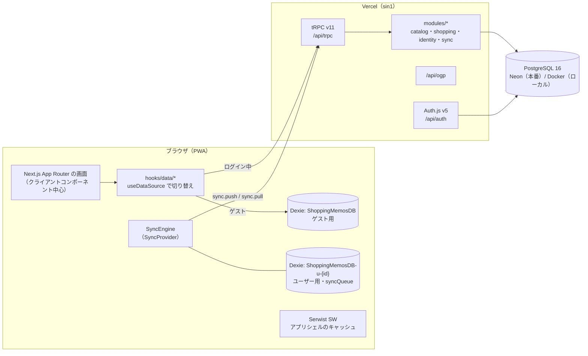
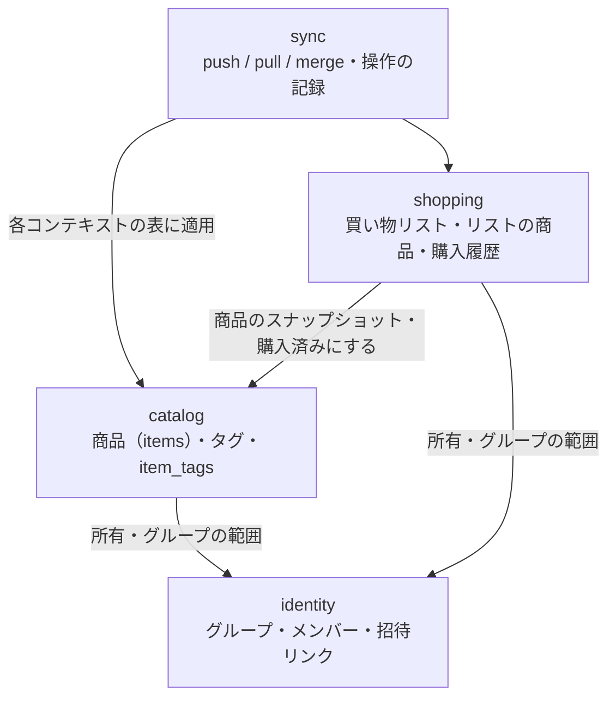
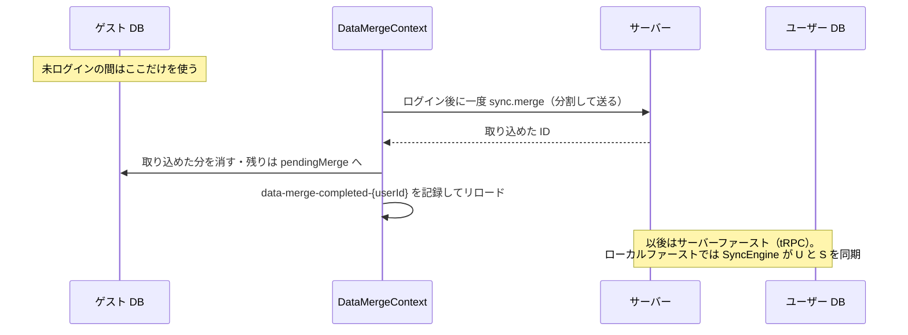
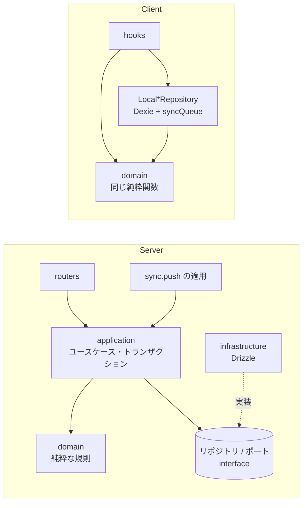

# Shopping Memos 設計書（Design Doc）

最終更新: 2026-11-17（develop の 392dbed、#62 O6b まで）

## 1. この文書について

- システム全体の今の構成と、これから目指す構造・リファクタの段取りをまとめる。新しく入った人（人もエージェントも）が全体を掴むための文書
- 機能ごとの振る舞いの正は `openspec/specs/`、進行中の変更は `openspec/changes/`（`.claude/rules/feature-design.md`）。タスクの正は GitHub Issues
- 同期（#62）の詳しい設計・実装ステップ・リリース手順は `docs/features/offline-support.md`。#62 が終わる（O11）までは #62 の設計の正として更新し続け、O7〜O9 の change は proposal / design でそこを参照し、振る舞いは change の specs に書く。#62 が終わったら同期の振る舞いを `openspec/specs/` に移し、offline-support.md は経緯の資料にする。offline-support.md と実装のずれは 7.9、ADR（`docs/adr/`）とのずれは「9. ADR との関係」
- コードと食い違ったらコードが正。気づいたらこの文書を直す（行番号は 392dbed 時点）

## 2. システムの全体像

家族と共有できるお買い物メモ帳の PWA。ログインなし（ゲスト）でもグループ以外の機能を端末内だけで使え、ログインするとグループ（家族）でデータを共有できる。



### 技術スタック（package.json）

| 分類 | 採用 |
|------|------|
| フレームワーク | Next.js 16.4（App Router）、React 19.2、TypeScript |
| API | tRPC v11 + TanStack Query v5（superjson） |
| 認証 | Auth.js（next-auth 5 beta）+ `@auth/drizzle-adapter`。今は Google OAuth だけ、セッションは JWT（`src/infrastructure/auth/index.ts`）。パスキー + メールへの移行は承認済み・未実装（#61、`docs/features/passkey-email-auth.md`） |
| サーバー DB | Drizzle ORM 0.45 / drizzle-kit、PostgreSQL 16（ローカルは Docker、本番・Preview は Neon） |
| ローカル DB | Dexie 4（IndexedDB）+ dexie-react-hooks |
| バリデーション | Zod v4（`src/shared/schemas/`。tRPC の入力とクライアントで共有） |
| PWA | Serwist 9（`src/app/sw.ts`）、`src/app/manifest.ts` |
| テスト | Vitest + Testing Library、Playwright（E2E）、実 DB のテスト（`npm run test:db`） |

### Service Worker（Serwist）

- ビルド時のマニフェストとアプリシェル（`src/lib/sw/config.ts` の URL）をプリキャッシュ。document の取得に失敗したら `/~offline`
- `/api/**` は NetworkOnly（Cache Storage に残さない）。RSC・document は NetworkFirst（3 秒）、画像は SWR、フォントは CacheFirst（`src/lib/sw/runtime-caching.ts`）
- 新しい SW は waiting で待ち、利用者が［更新］を選ぶと `SKIP_WAITING` で入れ替わる
- kill switch: `NEXT_PUBLIC_SW_ENABLED=false`（段階 1: 登録解除とキャッシュ削除）、`SW_KILL_SWITCH=true`（段階 2）。手順は offline-support.md「kill switch」

### 環境とデプロイ

| 環境 | ブランチ | Vercel | DB | migrate |
|------|---------|--------|----|---------|
| 本番 | main | Production | Neon の本番ブランチ | main への push（ci.yml `migrate`）。DB の変更を含むリリースは、マージ前に `migrate-production.yml` を手動で流す（#164） |
| Preview | develop | Preview | Neon の develop ブランチ | develop への push（ci.yml `migrate-develop`） |
| ローカル | 作業ブランチ | — | Docker の postgres | `npm run db:migrate`。E2E は実行ごとの DB（`npm run test:e2e:local`） |

- Vercel は main と develop だけデプロイする（`vercel.json`）
- CI: PR と main への push で lint・typecheck・unit test・coverage・build。E2E は main への PR と push だけ（develop への PR はローカルの E2E の件数を本文に書く）
- 運用の細かい規則は `.claude/rules/team-operation.md`

## 3. 境界づけられたコンテキストと層

### コンテキスト



| コンテキスト | 持つもの | 主なコード |
|-------------|---------|-----------|
| catalog | 商品（名前・数量・メモ・購入日時。URL の列はなく、メモの中の最初の URL から OGP を表示する）、タグ | `src/modules/catalog/`、`routers/catalog.ts` |
| shopping | 買い物リスト（status: in_progress / completed）、リストの商品（カタログのスナップショット）、購入履歴（`purchasedAt` が入ったリスト） | `src/modules/shopping/`、`routers/shopping.ts` |
| identity | グループ、メンバー（owner / member）、招待リンク（7 日・1 回） | `src/modules/identity/`、`routers/identity.ts` |
| sync | 同期操作の記録（`sync_operations`）、push・pull・ゲストのデータの merge | `src/modules/sync/`、`routers/sync.ts`、`src/infrastructure/sync/` |

- 共有カーネル: `src/shared/schemas/`（Zod・`limits.ts` の上限）、`src/infrastructure/db/ownership.ts`（自分のデータか所属グループのデータか）
- データの範囲（スコープ）: 個人のデータは `userId` で、グループのデータは `groupId` で持つ。tRPC では `middleware/groupAuth.ts` がメンバーかを確かめる

### 層の構成（今）

```
src/modules/<context>/
├── domain/
│   ├── entities/        # interface と入力の型（振る舞いはほぼない）
│   ├── value-objects/   # shopping/ListStatus.ts だけ中身がある（他は .gitkeep）
│   └── repositories/    # リポジトリの interface（一部が DbExecutor を import）
├── application/
│   ├── commands/ queries/   # .gitkeep だけ（ADR-003 の形は使っていない）
│   ├── services/        # catalog: CatalogSyncService, ownership / shopping: ShoppingService, ShoppingSyncService,
│   │                    # catalogItemScope / sync: SyncPushService, SyncPullService, DataMergeService（Drizzle を直接使う）
│   └── pushPatches.ts   # sync だけ（push のパッチの検証）
└── infrastructure/
    ├── repositories/    # Drizzle の実装
    └── entityAccess.ts  # sync だけ（エンティティごとの表と所有の判定）
src/infrastructure/trpc/routers/*.ts   # 入力の検証・認可・サービスの呼び出し（一部は業務ロジックと Drizzle を直接）
```

- identity には application のサービスがなく（commands / queries の .gitkeep だけ）、router がリポジトリを直接呼ぶ
- 純粋なドメイン規則の例: `shopping/domain/value-objects/ListStatus.ts`（`canTransition` / `isInProgress`）、`identity/domain/entities/InviteCode.ts`

### クライアントの構成

```
src/app/*            画面（page.tsx）
src/hooks/data/*     useItems / useTags / useLists / useHistory / useGroups と各 Mutation
                     useDataSource() で ゲスト=Dexie / ログイン中=tRPC を切り替える
src/lib/db/*         Dexie の定義（ShoppingMemosDB、version 10）と CRUD・ゲストのデータ
src/infrastructure/local/   ユーザー DB のリポジトリ（syncQueue と同じトランザクションで書く）・キューの圧縮
src/infrastructure/sync/    SyncEngine・サーバーの行の反映（applyServerRows）
src/contexts/*       Auth → DataMerge → Sync → Group の Provider（src/app/providers.tsx）
```

## 4. データの流れ

### 3 つのモード

| モード | 条件 | 読み書き先 |
|--------|------|-----------|
| ゲスト | 未ログイン、またはログイン直後で merge が終わる前 | ゲスト DB `ShoppingMemosDB`（Dexie）を hooks が直接読み書き |
| サーバーファースト | ログイン中で merge 済み（`useServer = !!user && isMergeCompleted`、`useDataSource.ts`） | tRPC。TanStack Query のキャッシュ |
| ローカルファースト（#62） | 上に加えて `NEXT_PUBLIC_LOCAL_FIRST=true` | ユーザー DB `ShoppingMemosDB-u-<id>` に書いて `syncQueue` に積み、SyncEngine が push / pull |

**O6 の時点の注意**: フラグを true にしても、変わるのは SyncEngine が `full`（push + pull）で動くことだけ。画面はまだユーザー DB を読まず、`infrastructure/local/repository.ts` の書き込みもテストからしか呼ばれていない。hooks をリポジトリ経由にするのは O7（catalog）・O8（shopping）。フラグの既定は false（`src/lib/featureFlags.ts`）で、false のとき SyncEngine は `drain`（残ったキューを送るだけ）。



- ログアウトすると merge 済みの印を消し、空のゲストに戻る（offline-support.md「4b」）
- グループの選択は `GroupContext`（`selectedGroupId`）。グループの一覧はログイン中は常にサーバーから読む（ゲストはグループなし）

## 5. 同期の仕組み（要約）

詳細は `docs/features/offline-support.md`「実装方針」。契約は `src/shared/schemas/sync.ts`。

### sync.push

- 入力: `{ protocolVersion, operations[≤100] }`。1 操作は `{ opId(uuid), entity: item|tag|list|listItem, entityId, type: create|update|delete|finishShopping|revertHistory, patch?, fieldTimes?, clientTime }`。複合操作（finishShopping / revertHistory）は list だけ
- 出力: `{ serverTime, results[{ opId, status, reason?, serverRow? }] }`。status は `applied` / `partial`（一部のフィールドが LWW で負けた）/ `duplicate` / `conflict`（削除済みなど。serverRow を返す）/ `rejected`
- サーバーの処理（`SyncPushService.ts`）: 1 操作 = 1 トランザクション。先に `sync_operations` に opId を記録して冪等にする（既にあれば duplicate、reason に最初の結果）。フィールド単位の LWW（`field_modified_at`）、削除は常に勝つ、未来の時刻は serverTime に丸める。他人の行への update・delete・複合操作は not_found、他人の行と同じ ID の create は `rejected:id_conflict`、他人の opId は `rejected:op_conflict`。対応外の protocolVersion は `CLIENT_TOO_OLD`

### sync.pull

- 入力: `{ cursor?, protocolVersion }`。出力: `{ serverTime, changes{tags,items,lists,listItems}, memberships{groupIds}, nextCursor, hasMore }`
- カーソル: エンティティごとの `(updated_at, id)` の位置（base64url の JSON。不透明として扱う）。1 回 500 行まで。各エンティティの最初のページだけ 60 秒さかのぼる
- 対象は自分のデータと所属グループのデータ。削除は `deletedAt` の入った行（tombstone）で返す。items には tagIds を埋め込む

### クライアント（`SyncEngine.ts`・`syncQueue.ts`）

- キューの状態: `pending` → `inflight` → 消える / `failed` / `pending`（再送）
- 圧縮: まだ送っていない pending の操作だけをまとめる（create+update → create、update+update → update、create+delete → 両方消す、update+delete → delete）。複合操作はまとめない
- 結果の扱い: applied / partial / conflict は消す（partial・conflict は未送信の操作がなければ serverRow を反映）。rejected は failed。duplicate は reason で分ける
- pull の反映では、pending / inflight の操作があるエンティティは上書きしない
- きっかけ: 今動くのは、起動・online・前面に戻ったとき（30 秒以上たっていれば）だけ。手動の `sync()` と書き込み後の `requestSync()`（2 秒のデバウンス）は API だけあり、呼び出しは O7〜O9 で足す。タブ間は Web Locks（`shopping-memos-sync-<userId>`）で 1 つだけ動く
- エラー: 401 は止める（sessionExpired）、CLIENT_TOO_OLD は止める、400 / 413 は半分に分けて送り直す、それ以外は指数バックオフ（2 秒〜5 分）

### まだのこと（#62）

- O7: catalog の hooks をリポジトリ経由に、初回の全件 pull（merge 後のゲスト DB の消去は #144 で実装済み。7.9）
- O8: shopping の hooks、finishShopping / revertHistory の複合操作
- O9: オフライン時のセッション保持、同期状態の UI、ログアウト時のユーザー DB の消去（`deleteUserDb` はまだ呼ばれない）
- O10（docs）、O11（サーバーファーストの分岐とフラグの削除）。リリースは O6〜O9 を R3 でまとめて出す

## 6. データモデル

サーバー（`src/infrastructure/db/drizzle/schema.ts`）:

| 表 | 役割 |
|----|------|
| users / accounts / sessions / verification_tokens | Auth.js |
| groups / group_members / invite_links / invite_code_attempts | グループ・メンバー・招待・招待コードの総当たり対策 |
| items / tags / item_tags | カタログ。`groupId` が null なら個人用 |
| shopping_lists / list_items | 買い物リストとリストの商品（カタログのスナップショット）。`purchasedAt` の入ったリストが購入履歴 |
| sync_operations | 同期操作の記録。push（id = opId、結果を payload に）のほか、tRPC の mutation（`DrizzleSyncRepository` 経由）と merge も書く |

- items・tags・shopping_lists・list_items には同期用の列 `updated_at`（pull のカーソル）・`field_modified_at`（LWW）・`deleted_at`（論理削除・tombstone）がある
- migration は expand（足すだけ）を先に出し、contract は別のリリースにする（team-operation.md「DB の変更を含むリリース」）

ローカル（`src/lib/db/index.ts`、Dexie version 10）: `tags`, `items`, `lists`, `listItems`, `groups`, `groupMembers`, `syncQueue`, `pendingMerge`, `meta`（cursor・serverTimeOffset・lastSyncAt・groupIds）。同じスキーマをゲスト DB とユーザー DB の両方に使う。スキーマの変更は `this.version(n)` を足す（既存は書き換えない）。

## 7. 現状の課題（DDD の点検、2026-11-17）

良い点: コンテキストごとに domain / application / infrastructure があり、リポジトリの interface は domain、Drizzle の実装は infrastructure にある。純粋なドメイン規則（ListStatus、InviteCode）と共有カーネル（limits.ts、ownership.ts）がある。

課題（重要度順）:

### 7.1 同じ業務規則が 3 か所にあり、ずれている

**finishShopping（買い物を完了）**: `ShoppingService.ts:47-167`（tRPC）、`SyncPushService.ts:289-321`（sync.push）、`hooks/data/useListMutations.ts:285-334`（ゲスト）

| 観点 | tRPC | sync.push | ゲスト |
|------|------|-----------|--------|
| チェック済み 0 件 | 完了できる | 完了できる | 例外（「購入済みのアイテムがありません」） |
| 状態の確認 | `isInProgress` / `canTransition` | status を見て conflict、LWW で古い操作を弾く | 確かめない |
| カタログの照合 | 名前・スコープで絞る。購入済みの行の `purchasedAt` も上書き | 名前・スコープ。opTime より新しい `purchasedAt` は変えない | 名前だけ（グループで絞らない）。未購入の行だけ |
| 未チェックの商品 | 論理削除（同期の記録は書かない） | 論理削除 | 物理削除 |
| リストの商品を読む時点 | トランザクションの外 | トランザクションの中でリストをロックして | — |

**revertHistory（履歴を取り消す）**: `routers/shopping.ts:536-588`、`SyncPushService.ts:328-350`、`hooks/data/useHistoryMutations.ts:35-76`

- tRPC はトランザクションがなく、カタログの更新・同期の記録・リストの戻しが別々に書かれる（途中で失敗すると片方だけ反映）。sync.push は 1 トランザクション + LWW
- スコープで絞るのはサーバーの 2 か所だけ。3 か所とも completed → in_progress に戻すが、`canTransition`（一方通行）を通らない

**その他の重複**:
- 進行中のリストにある商品をカタログの一覧から除く規則: `routers/catalog.ts:61-84`（Drizzle を router に直書き。論理削除・個人のスコープも見る）と `hooks/data/useItems.ts:36-45`（groupId だけ見る）
- リストの商品のスナップショット（カタログの名前などの写し）を手で書き写している: `routers/shopping.ts` の 4 か所（:164-176, :189-202, :295-306, :376-387）と `useListMutations.ts` の 4 か所。groupId の写し方が違う（サーバーはリストの groupId。ゲストは混在していて、:122・:149・:207 は item.groupId、:235・:248 はリストの groupId）

### 7.2 router に業務ロジックと Drizzle がある

- `routers/shopping.ts:536-588`（revertHistory の本体。商品ごとに更新する N+1）、`:351-354`（重複の確認）、`routers/catalog.ts:61-84`（除外規則）
- identity はサービスがなく、router がリポジトリを直接呼ぶ

### 7.3 application 層が Drizzle に直結し、トランザクションの境界があいまい

- サービスが `db` と `schema` を直接使う（`ShoppingService.ts`、`catalog/application/services/ownership.ts` など）
- shopping の `catalogItemScope.ts` が catalog の `items`・`item_tags` を更新する（:51-61, :76-87, :100-107）

### 7.4 domain が infrastructure に依存している

- `catalog/domain/repositories/ItemRepository.ts:1`、`TagRepository.ts:1`、`shopping/domain/repositories/ShoppingListRepository.ts:1` が `DbExecutor`（Drizzle の型）を import

### 7.5 コンテキストをまたいで具体実装を直接 import している

- `SyncPushService.ts:13-28` が shopping の `catalogItemScope`・catalog の `ownership`・Drizzle のリポジトリを import し、:366 あたりから :504 で各コンテキストの表に直接書く
- CatalogSyncService・ShoppingService・ShoppingSyncService が sync の具体的なリポジトリを import。`routers/shopping.ts:23-27` も他コンテキストのリポジトリ（catalog・sync・identity の Drizzle 実装）とサービス（CatalogSyncService）を直接使う
- ADR-002 の腐敗防止層（ACL）・ポートはない

### 7.6 エンティティが貧血で、不変条件が散らばっている

- エンティティは interface だけ（`Item.ts`、`ShoppingList.ts` など）。不変条件が Zod・サービス・router・hooks に分かれている

### 7.7 クライアントに独自のモデルがあり、hooks を通らない書き込みがある

- `src/lib/db/index.ts` の型がサーバーのエンティティと別に定義されている
- `app/items/new/page.tsx:50, :65` が `lib/db` の `createItem` / `createTag` を直接呼ぶ（ログイン中でもサーバーに送らない）。`app/groups/page.tsx:49, :59, :97` が tRPC の成功後に Dexie へ手で書く
- ゲストの Mutation は Dexie に直接書き、`syncQueue` を通らない（ゲストはそれで正しいが、ローカルファーストでは `infrastructure/local/repository.ts` を通す必要がある）

### 7.8 ADR-002 / 003 と実装がずれている（「9. ADR との関係」）

### 7.9 offline-support.md と実装のずれ（既知。offline-support.md の直しは別の PR）

| 項目 | offline-support.md | 実装（392dbed） |
|------|-------------------|----------------|
| ローカルファーストの範囲 | フラグが true ならログイン中もローカルファーストで動く（:383。O8 までそろった後の姿） | O6 ではフラグが true でも画面はユーザー DB を読まない。変わるのは SyncEngine が push + pull で動くことだけ（「4. データの流れ」の注意） |
| フラグの既定 | `NEXT_PUBLIC_LOCAL_FIRST` は「R3 以降の既定」が true（:383） | 値が `"true"` のときだけ有効で、既定は false（`src/lib/featureFlags.ts`）。R3 で環境変数を入れるのか既定を変えるのかは未定 |
| 同期のロックの名前 | `navigator.locks.request("sync")`（:392） | ユーザーごとの `shopping-memos-sync-<userId>`（`src/contexts/SyncContext.tsx:63`） |
| push の `duplicate` | 「`applied` / `duplicate` はキューから削除」（:390、テスト計画の :573）。:326 には reason で分ける記述もあり、文書の中で食い違う | reason で分ける: `applied` なら消す、`rejected:*` なら failed、それ以外は消して取り直す（`SyncEngine.ts` の `pushOutcome`） |
| 「現状」の表 | 2026-11-16 時点（Dexie v8、`public/sw.js` だけなど。:19-31） | Dexie v10、Serwist の SW |
| O7 の範囲 | O7 に「マージ後のゲスト DB 消去」を含める（:554） | #144 で実装済み。取り込めた行をゲスト DB から消し、残りを pendingMerge に移す（`src/lib/db/guestData.ts:163-182`） |
| 同期のきっかけ | 書き込み後・手動でも同期する（「4. 同期のタイミング」） | `requestSync()` / `sync()` を呼ぶ画面・hooks はまだない（O7〜O9） |

## 8. 目指す構造

### 方針

1. **業務規則は純粋関数（domain）に 1 つだけ置き**、サーバー（tRPC・sync.push）とクライアント（ゲスト・ローカルファースト）が同じ関数を呼ぶ。I/O（Drizzle・Dexie）はその外側
2. **依存の向きは infrastructure → application → domain**。domain は Drizzle・Dexie・tRPC などの外部や infrastructure に依存しない（入力の Zod スキーマは共有カーネルの `src/shared/schemas/` に置く）
3. **router は薄く**: 入力の検証・認可・application のユースケースの呼び出しだけ。トランザクションの境界は application のユースケースが持つ
4. **コンテキストをまたぐのはポート経由**: たとえば shopping は「カタログの商品を購入済みにする」ポート（interface）を domain / application に持ち、catalog がそれを実装する。sync はコンテキストごとの「操作を適用する」ユースケースを呼ぶだけにする
5. **クライアントもリポジトリ経由**: hooks は `LocalCatalogRepository` / `LocalShoppingRepository`（ユーザー DB と syncQueue を同じトランザクションで書く）か tRPC を呼び、画面から Dexie を直接触らない



### 共用する純粋関数の候補（最初の change）

| 規則 | 入力 → 出力 |
|------|-----------|
| 買い物の完了 | リスト・リストの商品・カタログの候補・時刻 → 完了後のリスト、購入済みにする商品、消すリストの商品（または 0 件のときの扱い） |
| 履歴の取り消し | 完了済みのリスト・商品 → 戻したリスト、未購入に戻す商品 |
| スナップショット | カタログの商品・リスト → リストの商品の写し（groupId の決め方を 1 つにする） |
| カタログとの照合 | リストの商品・カタログの商品・スコープ → 一致する商品 |
| 進行中リストでの除外 | カタログの商品・進行中のリストの商品 → 一覧に出す商品 |

### 決まっている振る舞いの変更（ユーザーの決定、2026-11-17。最初の change に入れる）

- チェック済みが 0 件で「買い物を完了」したときは、確認ダイアログで「リストの商品ごと消す」か「リストだけ消して商品は元に戻す」を選ばせ、そのうえでリストを削除する。履歴は作らない
- 今はサーバーは 0 件でも完了でき、ゲストは例外になる（7.1）。change の specs で 3 つのモードの振る舞いをそろえる

## 9. ADR との関係

ADR はその時点の決定の記録として残し、直しは別の PR（下の段取りの (5)）で行う。今の実装とのずれ:

| ADR | 書いてあること | 実装 |
|-----|--------------|------|
| 002 | コンテキストは Identity / Catalog / Shopping の 3 つ | sync モジュールがあり、他コンテキストの表に直接書く |
| 002 | commands / queries のファイル（CreateGroup、FinishShopping、RevertHistory など） | .gitkeep だけ。`*Service` / `*SyncService` が代わり |
| 002 | 値オブジェクト Quantity・Role、エンティティ User・PurchaseHistory | ない。数量は number、役割は `GroupRole` 型、履歴は `purchasedAt` の入ったリスト |
| 002 | domain/services/ShoppingService | application/services にあり、Drizzle を直接使う |
| 002 | ACL が必要 | ない。名前で照合して他コンテキストの表を直接更新 |
| 002 | in_progress → completed の一方通行 | revertHistory で戻せる |
| 002 | 未チェックの商品はそのまま残る | 削除する（サーバーは論理削除、ゲストは物理削除） |
| 002 | スナップショットの groupId は item.groupId | サーバーはリストの groupId |
| 003 | Command / Query の Handler、Item クラスと Item.create、Quantity | Handler はない。エンティティは interface |
| 003 | FinishShopping で PurchaseHistory を作り、ID で購入済みにする | 履歴の行は作らない。名前で照合 |
| 003 | 「現状」は Dexie で直接 CRUD | ゲストは今もそう。ログイン中は tRPC |
| 004 / 005 | オフライン同期・PWA | 今の設計は offline-support.md（ずれは 7.9）。ADR の更新は O10 |

## 10. リファクタの段取り（ユーザー承認済み）

```
(1) この PR: OpenSpec の導入、Issues との使い分け、この設計書
(2) 最初の change: 買い物の規則（完了・取り消し・スナップショット・カタログの照合・進行中リストでの除外）を
    共用の純粋関数にまとめ、サーバーの 2 か所（tRPC・sync.push）を置き換える。チェック 0 件の完了の変更もここ
    → shopping・catalog の今の振る舞いを specs に書き起こす
(3) O7・O8 の change の中で、クライアントのリポジトリ（LocalCatalogRepository / LocalShoppingRepository）を作り、
    (2) の関数を使って hooks の重複を消す。画面からの Dexie の直書き（7.7）もここで無くす
(4) R3 のリリース後、サーバー側: router を薄く、ポートで依存の向きを直し、lint（import の制限）で禁止する
(5) ADR-002 / 003（必要なら 004 / 005）を今の構造に合わせて更新する
```

- 各段は 1 つ以上の Issue と change（(4)(5) の振る舞いを変えない分は Issue だけ）で進める
- (2) の前に既存の振る舞いを specs に起こすので、(2) の change は「今の振る舞い（書き起こし）」と「変える振る舞い（差分）」の両方を持つ
- (3) は #62 のリリース R3 の範囲。O9 まで同時に出す方針（offline-support.md「リリース手順」）は変えない

## 11. 関連文書

| 文書 | 内容 |
|------|------|
| `AGENTS.md` | エージェント向けのプロジェクトガイド（コマンド・ディレクトリ） |
| `.claude/rules/*.md` | 運用ルール（Issues・OpenSpec・テスト・Git・チーム） |
| `openspec/config.yaml` | OpenSpec の成果物を書くときの前提と規則 |
| `docs/features/offline-support.md` | #62 オフライン対応の設計・リリース手順（#62 が終わるまで正。その後は経緯の資料） |
| `docs/features/passkey-email-auth.md` | #61 認証の変更の設計（参照用） |
| `docs/adr/001〜005` | 決定の記録 |
| `docs/ARCHITECTURE.md`・`docs/sync-implementation-status.md` | 以前の設計（2025-01）・同期の調査。今の実装と違う箇所があるので、この文書を優先する |
